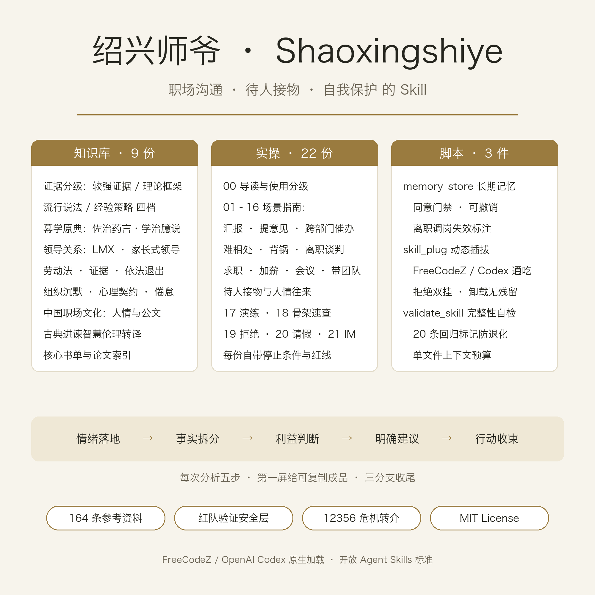

<!-- README_EN · synced with README v1.3 · 2026-10-12 -->

<p align="center">
  <a href="./README.md">简体中文</a> · <strong>English</strong>
</p>

<h1 align="center">Shaoxingshiye · 绍兴师爷</h1>

<p align="center">
  <strong>Not just drafting replies for you — helping you read the room, get things done, and keep your boundaries.</strong>
</p>

<p align="center">
  <a href="./LICENSE"></a>
  
  
  <a href="https://github.com/zzycxz/shaoxingshiye/stargazers"></a>
  <a href="https://github.com/zzycxz/shaoxingshiye/actions/workflows/validate.yml"></a>
</p>

The goal is **handling people and affairs well**: relationships that last, with dignity and boundaries. It covers the workplace battleground — reporting to your boss, raising disagreements, cross-team coordination, chasing deliverables, difficult colleagues, unfair blame, salary and promotion talks, meetings, job hunting, onboarding, layoffs and exit negotiations — as well as everyday hospitality and favors: hosting and visiting, dinner invitations, gift etiquette, holiday greetings, asking for help, apologies and thanks. Built on organizational-behavior evidence, Chinese workplace culture, Chinese bureaucratic-document craft, and labor-law self-protection, it turns complicated situations into an executable next step.

Named after the *shaoxing shiye* — the private advisors who assisted imperial magistrates: versed in rules and documents, they helped their patrons read the situation and get the job done, yet **assisted without abusing power**. That is this skill's founding principle.

## What it can help you with

| Your problem | How the advisor helps |
| --- | --- |
| How to phrase this reply / this email | A ready-to-send draft first, then timing and three follow-up branches |
| Want to disagree without offending your boss | Assess trust capital first, then a three-step approach with face-saving framing |
| Cross-team work won't move | Exchange-currency audit + a three-stage escalation ladder |
| A difficult boss, a colleague who dumps blame, being isolated | Classify (merely difficult vs. toxic), then respond by the ladder |
| Criticized or made a scapegoat, emotions running high | First-hour emotional first aid + a written-clarification template |
| Want a raise or promotion | One-page negotiation prep, timing, and branches after a refusal |
| Job hunting, offer negotiation, first 90 days | Offer checklist, onboarding map, probation rights |
| Being pushed out, non-competes, arbitration | The three "don'ts" on the spot, N/N+1/2N, playbook of pressure tactics |
| Tomorrow's hard conversation (review / talk / negotiation) | Dialogue drills: the advisor role-plays the other side, optional adversarial mode, five-dimension debrief |
| "How do I reply to this line?" | Skeleton quick-reference library: 40+ phrasing skeletons across 13 scenarios |
| Want the advisor to remember your workplace picture | Consent-gated local archive with undo and invalidation marking |

## Design principles

1. **Hold the person first, then solve the problem.** Advice — however correct — won't land while emotions are unseen.
2. **Evidence grading.** Meta-analyses, theoretical frameworks, popular claims, and practitioner heuristics are used separately; legal items go to official sources.
3. **Assist without abusing power.** Bureaucratic craft and classical persuasion wisdom are translated only into observable, correctable, opt-out-able abilities; taking the fall, informing, bribery and evidence fabrication are hard red lines.
4. **Self-protection is first-class.** Keeping records, avoiding blame traps, and exiting lawfully are modules in their own right — never "just endure it".
5. **No assumptions about your workplace.** Public vs. private sector, industry, employment form, remote vs. on-site, gender, age and background — solutions come from your concrete situation, never from stereotypes.

## Project structure

```text
shaoxingshiye/
├── SKILL.md                    # Core behavior and workflow
├── README.md / README_EN.md    # Docs in Chinese and English
├── LICENSE · CHANGELOG.md      # MIT license and changelog
├── CONTRIBUTING.md · SECURITY.md · CODE_OF_CONDUCT.md
├── .github/                    # CI (validate.yml) and issue/PR templates
├── documentation/              # Internal docs: architecture/product/flows/permissions
├── agents/
│   └── openai.yaml             # Codex display metadata and default prompt
├── assets/
│   └── skill-overview.png      # Capability overview
├── references/
│   ├── knowledge/             # 01–09: evidence-graded knowledge docs
│   └── practical/             # 00–22: scenario guides + drills, skeletons, register calibration & personal affairs
└── scripts/
    ├── memory_store.py         # Consent-gated local long-term memory (SQLite)
    ├── skill_plug.sh           # Dynamic plug/unplug for ZCode, Codex & Claude Code
    └── validate_skill.py      # Integrity self-check (regression markers, links, placeholders, token budget)
```

The knowledge base holds **164 references** (50 core picks: LMX, paternalistic leadership, issue selling, Gross's emotion regulation, bullying meta-analyses, official labor-law norms, the shaoxing-advisor canon *Zuozhi Yaoyan*, Han Fei's *Shuinan*, and more). Full index: `references/knowledge/09-核心书单与论文索引.md`.

<p align="center">
  <a href="./assets/skill-overview.png">
    
  </a>
</p>

## Install & use (dynamic plug/unplug)

This skill follows the open Agent Skills standard (agentskills.io) and works natively in ZCode, OpenAI Codex, and Claude Code. **Not installed by default** — mount it when needed, unmount when done:

```bash
scripts/skill_plug.sh on       # Mount at ~/.agents/skills (recognized by ZCode and Codex; Claude Code uses its own root below)
scripts/skill_plug.sh off      # Unmount
scripts/skill_plug.sh status   # Show mount status
scripts/skill_plug.sh on --root claude      # Mount at Claude Code's own root ~/.claude/skills
scripts/skill_plug.sh on --copy         # Whitelist-copy mode: copies the runtime (SKILL/references/scripts etc.) instead of symlinking the whole repo
scripts/skill_plug.sh on --root zcode       # Mount at ZCode's own root ~/.zcode/skills
```

Note: mount only one root at a time — hosts do not deduplicate same-named skills across roots (path is identity), so a double mount would show up twice; the script refuses it. Skill lists are scanned when a session starts, so mounting/unmounting takes effect in new sessions; already-discovered skills can be temporarily disabled via the Settings → skills toggles.

On Windows, run the script via Git Bash or WSL, or manually copy SKILL.md, agents, references, scripts and assets into a skill directory. Invocation (same across ZCode desktop/web/terminal and Codex): just describe your problem and the description auto-matches; or type `$` in the input box to pick from the skills panel; or write `/shaoxingshiye` in your message. `agents/openai.yaml` provides the display name and default prompt for the ChatGPT desktop app. Assistants that follow the SKILL.md standard (Claude Code etc.) work too — just place a copy in their skill directory.

Then start a session and say:

```text
Help me prepare for this review / this boss / this negotiation.
```

On first use you'll get a compact questionnaire (role, boss's style, key colleagues, the situation, goal, emotion) — leave anything blank and just tell your story.

## Boundaries

This skill provides workplace communication and decision support; it is not a substitute for a licensed attorney, psychotherapy, or medical advice. For concrete legal disputes, consult a professional. Self-check: `python3 scripts/validate_skill.py`.

## License

[MIT License](./LICENSE). Keep the copyright and license notices when redistributing.
